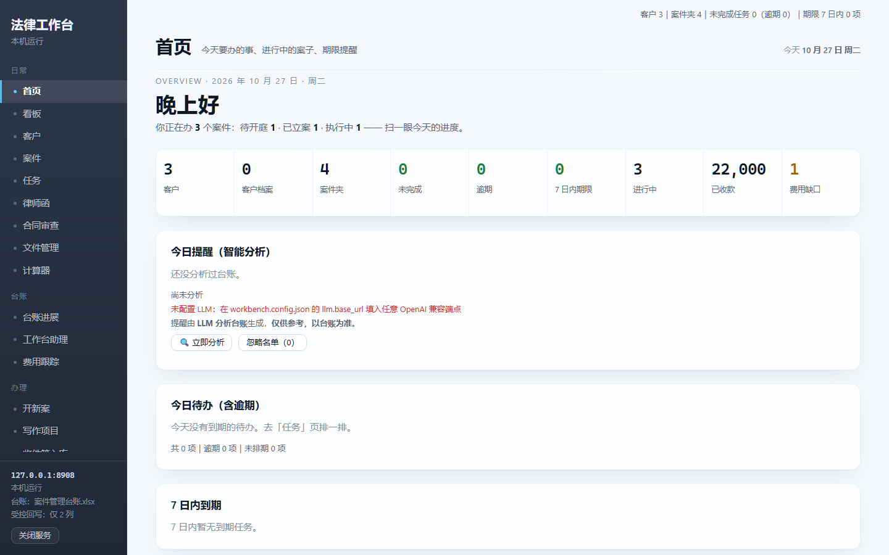

# 法律工作台（case-workbench）

[](https://github.com/lawyerllsx-dotcom/case-workbench/actions/workflows/ci.yml)
[](LICENSE)

**一个跑在浏览器里的本地案件工作台**：台账看板、案卷立卷、期限提醒、律师函与委托手续、收件箱入库——全部在本机，零外网、零账号、零云依赖。

> 目标不是做「又一套律所 SaaS」，而是把一位诉讼律师日常真正重复的几十个动作，收进一个能看懂、能改、能拆的本地工具里。
> **代码全部开源，数据一行不带走。**



<sub>首页 · 看板 · 案件 · 台账进展：[看板](docs/screenshots/board.png) ｜ [案件](docs/screenshots/cases.png) ｜ [台账](docs/screenshots/ledger.png)（均为 `demo_seed.py` 生成的虚构数据）</sub>

---

## 它解决什么问题

| 痛点 | 这里的做法 |
|---|---|
| 案件信息散在 Excel、微信、脑子和十几个文件夹里 | **台账是唯一事实源**，页面只是它的视图；改台账有闸门，不静默覆盖 |
| 收了一堆材料不知道放哪、放错了找不到 | 固定目录规范（`00-收件箱` … `10-处置分配`）+ 入库建议，**只移动不删除** |
| 期限靠记，保全到期忘续封 | 从台账抽出开庭/保全窗口，到期前 60/30/14 天提醒 |
| 律师函发出去没人管签收 | 发函台账 + 签收凭证 + EMS 单号识别 |
| AI 想帮忙，又怕它把台账写坏 | **写前断言、行快照比对、写后全簿审计**，AI 只能读不能乱写 |

---

## 30 秒跑起来

需要 Python 3.10+。

**Windows 双击 `start.bat`**；macOS / Linux 用 `./start.sh`。脚本会「生成示例数据 → 起服务」，全幂等。

手动三步：

```bash
pip install -r requirements.txt
python demo_seed.py        # 生成虚构的台账与案卷（3 个假案件），已存在则跳过
python verify.py           # 自检：依赖 / 配置 / 台账列映射 / 案卷 / 端口
python app.py              # 打开 http://127.0.0.1:8899
```

> 顺序很重要：**先 `demo_seed.py` 再 `verify.py`**，否则自检会提示「待生成」——那是首次使用的正常现象，不是装坏了。
> `verify.py` 退出码 1 才代表真有问题（配置错、列映射对不上）。

看到首页「3 个案件 / 应收 4.7 万」就是跑通了。演示数据全部虚构，可以随便点、随便改。

**文档导航**：

| 你是 | 先读 |
|---|---|
| 只想跑起来 / 让 AI 帮你部署 | [docs/DEPLOY.md](docs/DEPLOY.md)（含可直接粘贴给 agent 的提示词） |
| 想用起来 | 本文件「接自己的台账」 |
| 想让 AI 帮你改代码 | [AGENTS.md](AGENTS.md) |
| 想接自己的 LLM / OCR / 知识库 / 通知 | [docs/INTEGRATIONS.md](docs/INTEGRATIONS.md) |
| 想确认自己改的东西没坏 | `python run_all_tests.py` + `python smoke_views.py --demo` |

想换端口：`python app.py --port 8900`。

---

## 接自己的台账

工作台不认识「你的」台账，它认识**配置**。三步：

1. 复制配置模板：`workbench.config.example.json` → `workbench.config.json`
2. 改 `paths`：台账文件、在办案卷根目录、已结案目录、备份目录
3. 改 `ledger.cols_case`：把你的台账列名 → 列号（A=1、B=2 …）

```json
"paths": {
  "ledger": "D:/我的台账/案件管理台账.xlsx",
  "case_root": "D:/案件/在办",
  "archive_root": "D:/案件/已结案"
},
"ledger": {
  "sheets_case": ["案件", "其他案件"],
  "cols_case": { "序号": 1, "案号": 2, "案件": 3, "当前进度": 9, "进度日志": 10 }
}
```

**三个必填列**：`当前进度`、`进度日志`、`最新状态`——受控回写与「旧值留痕」依赖它们，缺了会在启动时报错（`verify.py` 会先提醒你）。其余列可缺，页面上显示为空。表头行数用 `ledger.data_start_row` 调（默认第 4 行起是数据）。

改完自查：

```bash
python config.py           # 打印当前生效的路径
python ledger_ops.py check # 台账体检：路径 / 锁 / sheet / 列映射
```

---

## 八条写死在代码里的纪律

这些不是文档承诺，是可验证的行为（配套 20 个接口测试 + 19 页渲染冒烟，实际数字以 `python run_all_tests.py` 输出为准）：

1. **一切写操作默认 dry-run**，要显式 `--apply` 或 `"confirm": true` 才落盘。
2. **绝不删除用户数据**：台账只追加/替换目标格；案卷只 `move` / `makedirs`。
3. **改「当前进度」前，先把旧值追加进「进度日志」**（`MM.DD：旧值`），旧值自带日期就原样照搬，不叠日期。
4. **写前备份 + 锁检测**：WPS/Office 打开着就拒写，备份按秒建目录。
5. **冲突不覆盖**：页面看到的内容与台账现状不一致 → 返回冲突 + 差异表，让人决定。
6. **写后全簿审计**：除目标格之外，整本工作簿应为零变化；有变化立即报警并指向备份。
7. **AI 只读**：助理能读台账与目录名，**绝不读案卷正文**，客户电话/微信不上行。
8. **路径白名单**：所有按路径取的接口先判越界、再判存在性，越界不泄露是否存在。

---

## 目录结构

```
app.py                 HTTP 服务与路由（stdlib http.server，无框架）
config.py              配置加载（路径 / 台账列映射 / 状态池）
ledger_ops.py          台账读写 + 受控回写（五重闸都在这里）
case_ops.py            立卷 / 收件箱入库 / 归档 / 业务线扫描
deadline_ops.py        期限与保全窗口
assistant_ops.py       工作台助理（可选：需要 OpenAI 兼容端点）
ocr_ops.py             本地 OCR 通道（可选：需要自备 PaddleOCR）
court_sms_ops.py       法院短信 → 文书拉取（可选）
static/                前端（原生 JS，无构建、无 CDN）
templates/             文书模板（自带骨架版，可换自己的）
tests/                 20 个接口回归（python run_all_tests.py）
docs/                  集成指南 / 路线图 / 截图 / 冒烟基线
extras/                作者环境专用工具（迁移、快捷方式等，仅供参考）
.github/               CI 与 issue 模板
demo_seed.py           示例数据生成器
verify.py              一键自检
sanitize_check.py      隐私自检（基线之外零新增）
```

**常用命令**

| 命令 | 作用 |
|---|---|
| `python verify.py` | 环境自检（依赖/配置/台账/案卷/端口） |
| `python demo_seed.py` | 生成演示数据（幂等，`--force` 重建） |
| `python app.py` | 启动（默认 8899，`--port` 改） |
| `python run_all_tests.py` | 20 个接口回归 |
| `python smoke_views.py --demo` | 19 页前端渲染冒烟（需 Node） |
| `python sanitize_check.py` | 隐私自检 |
| `make check / test / smoke` | 上面几条的快捷方式 |
---

## 可选组件（不配也能用）

| 组件 | 配什么 | 不配的后果 |
|---|---|---|
| AI 助理 / 智能提醒 | `llm.base_url`（任意 OpenAI 兼容端点）+ 密钥文件 | 助理页显示「未配置」，其余页正常 |
| 本地 OCR | `ocr.enabled` + `ocr.python`（自备 PaddleOCR 环境） | 入库页「本地识别」按钮不可用 |
| 桌面窗口 | 装 `pywebview` | 用浏览器打开，功能一样 |
| 卷宗装订 | 装 `PyMuPDF` | 该页提示缺少依赖 |

**任何情况下数据都不出本机**：页面只监听 `127.0.0.1`，前端无 CDN、无外链。

---

## 已知限制

- **示例数据下前端 19 页全部 PASS、20 个接口测试全部 PASS**（实际输出见 [docs/smoke_baseline.txt](docs/smoke_baseline.txt)）。
- **模板自带骨架版**：`templates/委托材料/`（六件套）与 `templates/所函模板.docx` 由 `demo_seed.py` 生成，可开箱使用；**正式出文书前请换成所内审定版本**（见 [templates/README.md](templates/README.md)）。
- **`smoke_views.py` 需要 Node**；`test_api_binding.py` 需要 PyMuPDF、`test_trace_ui.py` 需要 playwright——没装会 **SKIP 而不是 FAIL**。
- **Windows 优先**：toast 通知、桌面快捷方式、`os.startfile` 是 Windows 实现；其他系统能用主界面，通知类功能降级。
- **不替代备份**：所有闸门都假设你另有备份（工作台自己也会在写前备份）。
- **不做业务判断**：它只做归类、取数、留痕；案号、当事人、金额的准确性由人核验。
- **隐私自检带基线**：`sanitize.baseline.json` 里 39 条是**已人工确认的示例数据**（假路径、假案号），不是真实信息；新增命中才报错。

---

## 致谢与边界

- 部分功能（执行款跟踪、法院短信、写作项目、泳道看板）的**产品思路**参考了开源项目 **CaseBoard**（PolyForm Noncommercial 1.0.0）。本项目为**独立重实现**：不复制其代码、素材、图标、名称与文案；如需商用请自行评估相关风险。
- 其余代码为本项目原创，MIT 许可，见 [LICENSE](LICENSE)。

---

## 给 AI 的接入提示

如果你要让 AI（Claude Code / WorkBuddy / Cursor）操作这套工作台，建议先装同作者的另一个小工具 **write-guard**（另一个仓库，`assert` / `stamp` 两个命令），在 `AGENTS.md` 里写死一条：

> 写任何已存在的文件之前，先跑 `python write_guard.py assert <路径>`；退出码 1 表示有人手改过，禁止整体重写。

这比在提示词里写十遍「不要覆盖用户修改」都管用。
